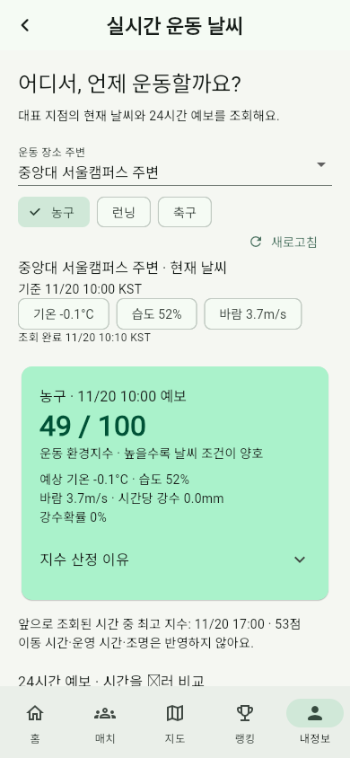
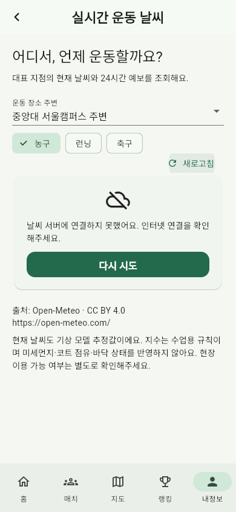

# HTTP 과제 검증 결과

검증일: **2026-11-20 (KST)**

환경: macOS, Flutter 3.47.4, Dart 3.13.3, Google Chrome.

| 검증 | 결과 |
|---|---|
| `flutter analyze` | No issues found |
| `flutter test --reporter expanded` | **64개 통과** (기존 46 + 신규 18) |
| `flutter build web --release` | 성공 |
| `flutter build apk --debug` | 성공 |
| `dart run tool/check_weather_api.dart` | 실제 Open-Meteo HTTPS GET 및 JSON 파싱 성공, 시간별 24개 |
| 실제 Chrome, 390×844 | DEMO 로그인 → 홈 구름 아이콘 → 실시간 날씨 진입, HTTP 200 |
| 브라우저 Offline | 새로고침 → 연결 오류/재시도 표시, 가짜 날씨·점수 표시 없음 |
| 브라우저 온라인 복귀 | 다시 시도 → HTTP 200 → 날씨 화면 복구 |
| 브라우저 pageerror | 0개 |
| 작은 화면·큰 글자 | 360×740, 글자 200%, 다크 모드 스크롤/펼침 위젯 테스트 통과 |
| `git diff --check` | 통과 |

실제 조회 예시: 중앙대 서울캠퍼스 주변, 모델 기준 **11/20 10:00 KST**, 기온 **-0.1°C**, 풍속 **3.69m/s**, 시간별 예보 **11/20 10:00 ~ 11/21 09:00 KST**. 날씨 값은 조회 시점에 따라 바뀌므로 고정된 점수를 기대하지 않는다.

## 시연 화면

아래 이미지는 실제 Chrome에서 공개 API를 호출한 결과이며 테스트용 가짜 응답을 사용하지 않았다. 문서용 캡처로, Flutter의 런타임 `assets/`에는 포함되지 않는다.

| 실시간 조회 성공 | 네트워크 연결 끊김 |
|---|---|
|  |  |

## 신규 자동 테스트 18개

- 서비스/계산 13개: HTTPS GET·좌표·단위·JSON·KST, HTTP 429/500, 연결 실패, 타임아웃, 잘못된 JSON/누락/null/배열 길이/단위/시간 순서/범위, 종목별 강수 감점·위험 조건 상한·점수 범위.
- 화면 5개: 로딩→오류→재시도→성공·새로고침·종목 변경 시 추가 요청 없음·시간 선택, 이전 장소의 늦은 응답 무시, 종료된 화면의 응답 무시, 작은 화면/글자 200%/다크 모드, 실제 앱 홈 진입과 내정보 복귀.
- 자동 테스트는 HTTP 클라이언트/서비스 경계를 주입하고, 별도의 실제 API 조회와 Chrome 실행으로 실제 연결도 확인했다.

## 검증 범위와 기존 제한

- Android는 debug APK **빌드**를 확인했다. 실기기에서의 조작 검증은 별도로 수행하지 않았다.
- 원본의 Kotlin 2.2.20 및 Kotlin Gradle Plugin 관련 향후 Flutter 호환성 경고가 있으나 현재 빌드는 성공했다. 이번 과제에서 SDK/Gradle 마이그레이션은 하지 않았다.
- OpenAI 채팅은 키 미설정 상태이며 실제 유료 API 답변은 검증하지 않았다. 이번 날씨 과제 시연에는 영향이 없다.
- 날씨 서버 장애·요청 제한 시 오류를 표시한다. 인터넷 없는 환경에서 실시간 값이 표시되는 기능은 아니다.
- 계정·프로필·캘린더는 기존 로컬 저장 방식을 유지한다. 서버 회원 동기화, 코트 점유, 실제 매칭/랭킹은 이번 구현 범위가 아니다.
